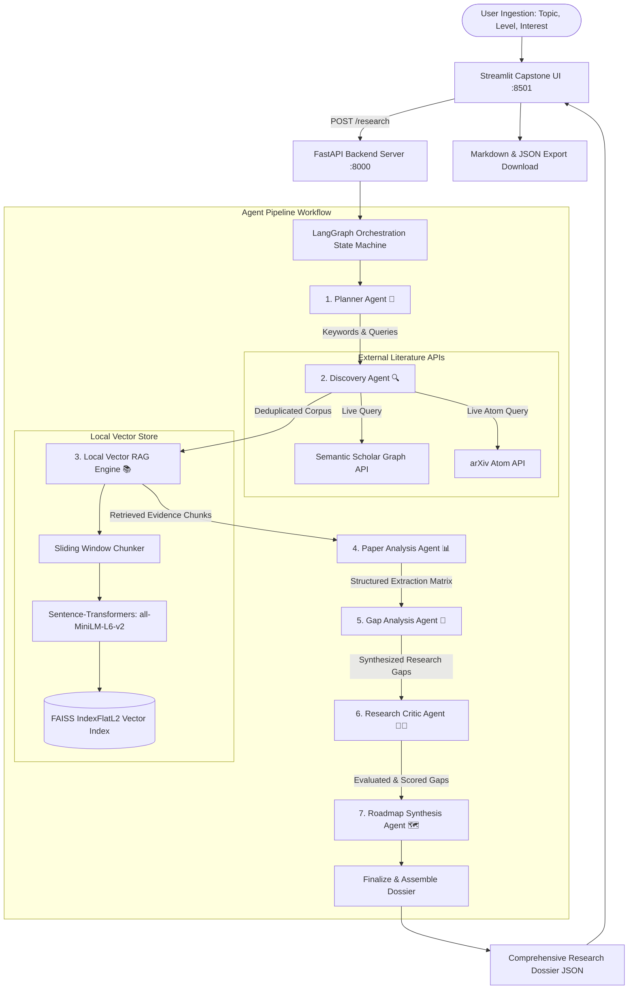

# 🎓 ReSearchAI: Autonomous AI Research Mentor & Roadmap Synthesizer

> **Atomcamp Agentic AI Bootcamp — Final Capstone Project**  
> An autonomous multi-agent platform powered by **LangGraph**, **Groq LLMs**, **Local FAISS Vector RAG**, **arXiv**, **Semantic Scholar**, **FastAPI**, and **Streamlit**.

---

## 🌟 Executive Summary & Problem Statement

Students, junior researchers, and early-stage practitioners often struggle with the transition from a broad research inquiry to a rigorous, novel, and scientifically grounded research direction. Traditional workflows suffer from two fundamental bottlenecks:
1. **Literature Dumping Without Synthesis**: Keyword searches return hundreds of unranked papers without cross-paper synthesis or methodology comparison.
2. **LLM Hallucinations**: Standard generative models frequently fabricate citations, invent non-existent datasets, and propose untestable or already-solved research directions.

**ReSearchAI** solves this by orchestrating **7 specialized autonomous AI agents** in a deterministic state graph:
- Translates vague user topics into structured academic research questions and keywords.
- Simultaneously harvests peer-reviewed literature across academic repositories (**arXiv** & **Semantic Scholar**).
- Chunks and indexes literature in an **in-memory FAISS vector database** using dense neural embeddings (`all-MiniLM-L6-v2`).
- Grounded extraction of methodologies, datasets, and limitations using strictly constrained in-context RAG evidence.
- Cross-paper meta-analysis to synthesize verified research gaps.
- Independent **adversarial peer critic** stress-testing each gap with strict reviewer verdicts.
- Generates a tailored **4–8 week actionable execution roadmap** with milestones, benchmark metrics, validation gates, and risk mitigations.

---

## 🏗️ Multi-Agent Architecture & Workflow

ReSearchAI is built upon a linear compiled **LangGraph** state graph pipeline where each agent acts as a specialized node that mutates and enriches a typed `ResearchState`.



---

## 🤖 The 7 Autonomous Agents & Core Components

| # | Agent / Module | Responsibility | Prompting & Logic Strategy | Primary Output Schema |
|---|---|---|---|---|
| **1** | **Planner Agent** | Deconstructs user input into structured inquiry dimensions, subtopics, and search keywords. | Academic Director persona; strictly forces structured JSON with subtopics, inquiries, and search terms. | `PlannerOutput` |
| **2** | **Discovery Agent** | Concurrently queries arXiv and Semantic Scholar APIs, extracting paper titles, authors, venues, years, citations, and abstracts. | Multi-source querying with intelligent fallback and dual-pass deduplication (normalized paper ID + title). | `List[Paper]` |
| **3** | **Local Vector RAG Engine** | Ingests paper content, performs sentence-aware chunking, generates embeddings, and retrieves relevant chunks via FAISS. | In-memory `IndexFlatL2` dense vector retrieval with cosine similarity filtering; no external vector database dependency. | `List[Dict]` (Evidence Chunks) |
| **4** | **Paper Analysis Agent** | Deeply extracts problem formulation, experimental setup, datasets, findings, limitations, and future work. | **Strict Grounding Rules**: Must state *"Not specified in the available evidence"* if absent; strictly forbids external speculation. | `List[PaperAnalysis]` |
| **5** | **Gap Analysis Agent** | Cross-paper meta-comparison identifying repeated constraints, methodology bottlenecks, or conflicting results. | Cautious scientific framing (*"Within the supplied sample..."*); classifies gap types (Dataset, Methodology, Evaluation, etc.). | `List[ResearchGap]` |
| **6** | **Research Critic Agent** | Acts as an adversarial peer reviewer, independently validating whether the evidence genuinely supports each identified gap. | Skeptical reviewer persona; assigns verdicts (**Supported**, **Partially Supported**, **Weak / Needs More Evidence**) with explicit reasoning and caveats. | `List[CriticResult]` |
| **7** | **Roadmap Synthesis Agent** | Converts validated gaps into an actionable research roadmap calibrated to the user's experience level. | Filters out weak claims; structures phased implementation steps, required datasets, evaluation metrics, and validation checkpoints. | `RoadmapResult` |

---

## 💻 Streamlit UI & Interactive Features

The frontend dashboard (`frontend/app.py`) provides an editorial SaaS research studio with high visual contrast and responsive design:

- **High-Contrast Dark Theme**: Custom CSS design system optimized for readability (`#080d1a` background, `#38bdf8` accent, slate cards).
- **Curated Topic Presets**: One-click quick-start presets across key domains:
  - 🧬 *AI in Healthcare Diagnosis*
  - 🛡️ *LLM Hallucination Mitigation via Self-Reflective RAG*
  - ⚛️ *Quantum Machine Learning for Drug Discovery*
  - 🤖 *Autonomous Swarm Robotics & Decentralized SLAM*
- **Real-Time Progress Visualizer**: Multi-stage progress bar with dynamic elapsed-time counter that tracks each agent in the pipeline.
- **Executive KPI Metric Strip**: Instant summary cards displaying count of papers discovered, RAG extractions, identified gaps, critic evaluations, and roadmap timeline.
- **5 Comprehensive Studio Tabs**:
  1. **📄 Discovered Literature & Evidence**: Formatted cards featuring source badges (arXiv / Semantic Scholar), publication year, citation counts, venue, authors, direct external paper links, and full expandable abstracts.
  2. **🗺️ Actionable Research Roadmap**: Strategic objective, core direction, central research questions, methodology, dataset requirements, benchmark metrics, phased implementation milestones, and anticipated technical risks.
  3. **🔎 Research Gaps & Peer Critic**: Side-by-side comparison of discovered research gaps and independent adversarial critic reviews with color-coded verdict badges (`Supported`, `Partially Supported`, `Skeptical / Rejected`).
  4. **📊 Deep RAG Extraction**: Comprehensive per-paper breakdown of methodologies, datasets, limitations, and raw FAISS vector snippets.
  5. **📋 Research Strategy & Plan**: Initial Planner Agent strategic roadmap and subtopic decomposition.
- **One-Click Dossier Export**: Download the entire research dossier as formatted **Markdown (`.md`)** or machine-readable **JSON (`.json`)**.

---

## 🛠️ Technology Stack & Dependencies

- **Orchestration**: LangGraph, LangChain
- **LLM Inference**: Groq API (`qwen/qwen3.8-27b`, `llama3-70b-8192`)
- **Embeddings & Vector Store**: `sentence-transformers` (`all-MiniLM-L6-v2`), `faiss-cpu`
- **Academic APIs**: Semantic Scholar Academic Graph API, arXiv Atom Query API
- **Backend Framework**: FastAPI, Uvicorn, Pydantic v2
- **Frontend Dashboard**: Streamlit (Custom Dark Theme & Visualizer)
- **Validation & Schemas**: Pydantic v2 data models with custom sanitization validators
- **Testing**: Pytest (56 unit & integration tests)
- **Containerization**: Docker, Docker Compose

---

## 📁 Repository Directory Structure

```text
ReSearchAI/
├── .env.example              # Sample environment configuration template
├── .env                      # Local environment secrets (API keys)
├── Dockerfile                # Multi-stage container definition
├── docker-compose.yml        # Docker compose configuration (Backend + Frontend)
├── requirements.txt          # Python package dependencies
├── README.md                 # Project documentation
│
├── backend/                  # FastAPI backend and agent engine
│   ├── __init__.py
│   ├── config.py             # Environment loader and global settings
│   ├── main.py               # FastAPI application entry point & endpoints
│   ├── agents/               # 6 specialized agent implementations
│   │   ├── __init__.py
│   │   ├── planner.py        # Phase 2: Planner Agent
│   │   ├── discovery.py      # Phase 3: Paper Discovery Agent
│   │   ├── analysis.py       # Phase 4: Grounded Paper Analysis Agent
│   │   ├── gap_analysis.py   # Phase 5: Gap Analysis Agent
│   │   ├── critic.py         # Phase 7: Research Critic Agent
│   │   └── roadmap.py        # Phase 8: Roadmap Synthesis Agent
│   ├── graph/                # LangGraph state machine definition
│   │   ├── __init__.py
│   │   ├── state.py          # Typed ResearchState definition
│   │   └── research_graph.py # Compiled StateGraph pipeline
│   ├── rag/                  # Local vector retrieval engine
│   │   ├── __init__.py
│   │   ├── loader.py         # Paper content extractor
│   │   ├── chunker.py        # Sliding-window document chunker
│   │   ├── vector_store.py   # FAISS VectorStore with all-MiniLM-L6-v2
│   │   └── retriever.py      # Similarity search retriever
│   ├── schemas/              # Pydantic v2 models and schemas
│   │   ├── __init__.py
│   │   ├── paper.py          # Paper data schema
│   │   ├── planner.py        # PlannerOutput schema
│   │   ├── analysis.py       # PaperAnalysis schema with validators
│   │   ├── gap.py            # ResearchGap schema with validators
│   │   ├── critic.py         # CriticResult schema
│   │   ├── roadmap.py        # RoadmapResult schema
│   │   └── research.py       # ResearchRequest and ResearchResponse
│   └── tools/                # External academic retrieval clients
│       ├── __init__.py
│       ├── arxiv.py          # arXiv Atom API client
│       └── semantic_scholar.py # Semantic Scholar API client
│
├── frontend/                 # Streamlit web application
│   ├── __init__.py
│   └── app.py                # Editorial research studio & dashboard
│
└── tests/                    # 56 automated unit and integration tests
    ├── __init__.py
    ├── test_analysis.py      # Paper analysis & grounding tests
    ├── test_backend.py       # FastAPI endpoint tests
    ├── test_critic.py        # Critic agent tests
    ├── test_discovery.py     # Discovery & deduplication tests
    ├── test_e2e_discovery.py # End-to-end literature fetching tests
    ├── test_gap_analysis.py  # Gap analysis & validator tests
    ├── test_graph.py         # LangGraph execution tests
    ├── test_rag.py           # FAISS vector store & retrieval tests
    └── test_roadmap.py       # Roadmap synthesis tests
```

---

## 🚀 Installation & Getting Started

### 1. Prerequisites
- Python 3.10 to 3.13
- Git

### 2. Clone Repository
```bash
git clone https://github.com/your-username/ReSearchAI.git
cd ReSearchAI
```

### 3. Create & Activate Virtual Environment
**On Windows (PowerShell):**
```powershell
python -m venv venv
.\venv\Scripts\Activate.ps1
```

**On macOS / Linux:**
```bash
python3 -m venv venv
source venv/bin/activate
```

### 4. Install Dependencies
```bash
pip install -r requirements.txt
```

### 5. Configure Environment Variables
Copy `.env.example` to `.env` in the root directory:
```bash
cp .env.example .env
```
Populate `.env` with your API credentials:
```env
# Groq Inference API (Required)
GROQ_API_KEY=your_groq_api_key_here
GROQ_MODEL=qwen/qwen3.8-27b

# Academic APIs (Optional, enhances rate limits)
SEMANTIC_SCHOLAR_API_KEY=your_optional_semantic_scholar_key

# LangSmith Observability & Cloud Tracing (Optional)
LANGCHAIN_TRACING_V2=false
LANGCHAIN_API_KEY=your_optional_langsmith_key
LANGCHAIN_PROJECT=ReSearchAI
```

---

## 🏃 Running the Application

### Option A: Local Native Execution (Recommended for Development)

Run the backend and frontend in two separate terminal windows:

**Terminal 1 — FastAPI Backend Server:**
```bash
python -m uvicorn backend.main:app --host 127.0.0.1 --port 8000 --reload
```
- API Base: `http://127.0.0.1:8000`
- Interactive Swagger Documentation: `http://127.0.0.1:8000/docs`
- ReDoc Documentation: `http://127.0.0.1:8000/redoc`

**Terminal 2 — Streamlit Frontend Studio:**
```bash
python -m streamlit run frontend/app.py --server.port 8501
```
- Open your browser (e.g., Microsoft Edge or Google Chrome) to [**http://localhost:8501**](http://localhost:8501).

---

### Option B: Docker Compose

You can launch both the backend and frontend with Docker Compose:

```bash
docker compose up --build
```
- Streamlit Interface: `http://localhost:8501`
- Backend API: `http://localhost:8000`

---

## 🧪 Testing & Quality Assurance

ReSearchAI is backed by a test suite of **56 automated unit and integration tests** verifying Pydantic schema validation, agent nodes, error recovery, vector indexing, and backend routing:

```bash
python -m pytest
```

### Test Coverage Highlights:
- `test_analysis.py`: Verifies strict evidence rules, missing-data fallbacks, and schema adherence.
- `test_backend.py`: Validates FastAPI `/health` and `/research` endpoints.
- `test_critic.py`: Asserts correct reviewer verdicts (`Supported`, `Partially Supported`, `Weak`).
- `test_discovery.py` & `test_e2e_discovery.py`: Tests arXiv and Semantic Scholar parsers, query generation, and ID/title deduplication.
- `test_gap_analysis.py`: Tests cross-paper synthesis, confidence normalization, and category validation.
- `test_graph.py`: Verifies compiled LangGraph StateGraph traversal and state propagation.
- `test_rag.py`: Verifies sliding-window chunking, FAISS index construction, dense embedding generation, and nearest-neighbor search.
- `test_roadmap.py`: Tests roadmap milestone generation, timeline validation, and risk formatting.

---

## 📜 Capstone Submission Deliverables

| Deliverable | Description | Status / Link |
| :--- | :--- | :--- |
| **1. GitHub Repository** | Clean, modular codebase, passing test suite, and architecture documentation. | [GitHub Repository](https://github.com/) |
| **2. Demo Video** | 2–5 minute presentation covering problem statement, live agent demo, and architecture. | [Demo Video Link]() |
| **3. Live Application / Docker** | Multi-container setup via `docker compose up --build`. | Ready (`docker-compose.yml`) |

---

## 📄 License

This project is licensed under the MIT License — see the [LICENSE](LICENSE) file for details.
